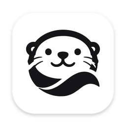

<p align="center"></p>

<h1 align="center">Otter</h1>

<p align="center">An inbox for your development work on remote machines.</p>

<p align="center"><a href="https://github.com/alvingaopro/otter-releases/releases/latest"><b>Download the latest release</b></a></p>

Run Claude Code, Codex, shells, dev servers and tests on your dev boxes, and
keep track of all of them from one Mac app, the terminal or Slack. Work lives
in **workspaces** on your hosts and keeps running when your laptop sleeps;
Otter tells you when something needs you. Or hand Otter a **task**: the
coding agent on the host answers it, or builds it and opens the pull
request, and Otter keeps it moving — scheduling, preparing the machine,
following CI — and brings you only what is yours to decide.

Otter is not another coding agent. The coding agent does the work; Otter
does what the agent can't do for itself: keep it running somewhere that
isn't your laptop, give it a working machine, and tell you when it needs you.

This repository holds Otter's releases and its documentation for users. The
source code is not public.

## What it does

### Workspaces you can leave

- **Workspaces, not terminals.** A workspace is one piece of work on a host:
  its files (an empty folder, a Git worktree of your repository, or an
  existing folder) and its sessions — Claude Code, Codex, shells, dev
  servers, tests. Agents can work side by side in worktrees of their own.
- **Persistent sessions.** Sessions live on the host. Close the app, lose
  Wi-Fi, restart the daemon: they keep running, and the terminal reattaches
  with its history.
- **What needs you, first.** Every workspace on every host, grouped into
  **Needs you**, **Working**, **Completed** and **Idle**. An agent that
  finished its turn or waits for approval, or a command that failed, moves
  to the top, with a macOS notification and a count in the menu bar.
- **Coding agents that resume.** Otter follows Claude Code's and Codex's
  transcripts to know when they're working, done or blocked; restarting a
  session resumes its conversation.
- **Services of its own.** A repository's compose services (Postgres, Redis,
  …) run in a **pod** per workspace — and per worktree — so two agents never
  share a database. `otter-svc` in a session runs tests and servers against
  them; the pod's own browser is on a screen you can watch or take over from
  the app, with sign-ins saved for the host.
- **From your Mac.** Paste a screenshot into Claude Code with **Ctrl+V**.
  `aws sso login`, `gcloud auth login`, `gh auth login` run on a host open
  their sign-in page in your Mac's browser. Browse, download and upload
  files. Map any port a host listens on to your Mac, and back.
- **Host dashboard.** CPU, memory, disks, network, the busiest processes and
  trends over an hour to 30 days, and every Claude Code and Codex account's
  plan limits with what each task cost.

### Tasks you hand over

- **Say what you want.** In a workspace, in your words. The coding agent
  reads the code; a question gets its answer, pointing to the code, and a
  change gets designed, built, tested, reviewed by the agent itself, pushed,
  and opened as a pull request. When CI fails it is woken with the failure.
  Merging is yours; Otter never merges or deploys.
- **You stay in charge.** Talk to the task at any time: Otter passes on what
  the agent should know, redirects it, pauses it. The agent's own permission
  mode decides what runs, inside a sandbox; what your policy says is yours
  waits for you.
- **Otter in Slack.** A direct message to your Slack app is a message to
  Otter: start tasks, ask where things stand, answer what waits on you with
  buttons. One Slack app can serve all your hosts (`otter hub`).
- **Unattended work.** Triggers start tasks on a schedule, under a policy
  set in advance: whether it may publish, how long a decision may wait, its
  budget. Watches have Otter look at something again later (CI, a time) and
  come back to you.
- **Memory and skills.** Otter remembers what you tell it, per conversation,
  across them and per repository, and writes its own skills, in a Git
  repository you own. Repository rules and coding skills reach every coding
  agent it starts.

### No server to run

Hosts are anything you reach with `ssh`. Otter installs and updates its
small daemon (`otterd`) there; nothing listens on the network. A CLI,
`otter`, does everything the app does, with `--json` for scripts.

## Install

From the [latest release](https://github.com/alvingaopro/otter-releases/releases/latest):

- **Mac app:** `Otter_<version>_macos_arm64.dmg` (Apple silicon only). Drag
  Otter to Applications. It isn't notarized by Apple yet, so the first
  launch needs **System Settings → Privacy & Security → Open Anyway** (or
  `xattr -dr com.apple.quarantine /Applications/Otter.app`). After that it
  updates itself.
- **Command line:** in the app, **Otter → Install Command Line Tools…**
  (installs `otter` into `~/.local/bin`), or take
  `otter-<version>-<platform>.tar.gz` (macOS arm64, Linux x86_64), which
  holds `otter` and `otterd`.

**A host** needs `ssh` access from your Mac, tmux 3.2 or newer, and curl or
wget; Otter installs what else it needs (Node, direnv, `gh`) into its own
directory. Pods need Docker on the host, and their screen Nix. A coding
agent — Claude Code or Codex — signed in on the host. `otter doctor` says
what a host is missing and what to do about it.

## Quick tour

1. **Add a host.** Open Otter → **Add a host** → a name and its SSH
   destination (as in `~/.ssh/config`, or `user@host`), or **This Mac**.
   Without `otterd`, click **Install otterd and add**.
2. **Start a workspace.** **New** (⌘N) → a name, the host, and its files: an
   empty folder, a Git repository (its own worktree and branch), or an
   existing folder. Pick **Claude Code** or **Codex**, optionally with a
   prompt. **Create**.
3. **Work in it.** Each session is a tab with a live terminal; **+** adds a
   shell, another agent, a dev server or a test command.
4. **Leave it.** Close the window or the laptop. When an agent finishes or
   asks for approval you get a notification and the workspace moves to
   **Needs you**.
5. **Hand over a task.** **New task** → what you want, and the workspace to
   do it in. What's yours to decide shows up first in **Chat** (⌘1), as a
   notification, and in Slack if you've set it up.

### From the command line

```sh
otter host add dev-01                                 # anything `ssh dev-01` reaches
otter new billing --repo git@github.com:org/api.git --agent claude --prompt "Fix the flaky test"
otter ls --watch                                      # NEEDS YOU / WORKING / …
otter attach billing/claude                           # Ctrl-] detaches; it keeps running
otter ack billing                                     # mark what it asked for as handled

otter task new "CSV export" --request "Export the timeline as CSV" --workspace billing
otter task start csv                                  # a task by its id, title, or the start of one
otter task show csv                                   # where it stands, what waits on you
otter chat "what's waiting on me?"                    # talk to Otter on a host
```

<details>
<summary>All commands</summary>

```
otter host add|list|remove|default|status|install|shutdown
otter doctor [host]                  # what's wrong with your hosts, and what to do
otter new | start | attach | logs | send | ack | ls
otter workspace show|prepare|archive|unarchive|rename|brief|delete
otter session stop|restart|delete|rename
otter task new|ls|show|history|start|message|redirect|interrupt|cancel|pause|resume|budget|decide
otter trigger add|ls|rm|run          # work that starts by itself
otter watch ls|stop|rm               # what Otter looks at again later
otter chat [text]                    # Otter's conversation on a host
otter conversation ls|show|history   # the coding agent's conversations
otter runtime status|test|pods|sandbox
otter usage [--by …]                 # plan limits, tokens and their cost
otter hub setup|serve|status|add|remove|stop|leave   # one Slack app for all hosts
otter events [-f]
```

`otter <command> --help` says more; add `--json` to any command for
machine-readable output.
</details>

## How it works

```
Otter.app / otter / Slack ──ssh──▶ otterd (one per host) ──▶ Claude Code, Codex, shells…
          ▲                              │                └─▶ pods ──▶ a workspace's services
          └──── events, attach ──────────┘   state in ~/.otter on the host
```

Everything runs on the host under `otterd`, reached over your own SSH; the
daemon is the source of truth, so the app and the CLI can come and go.
Your code, credentials and agents' conversations stay on your hosts.

## What's in a release

- `Otter_<version>_macos_arm64.dmg` — the Mac app.
- `otter-<version>-<platform>.tar.gz` — `otter` and `otterd`.
- `otter-claude-runtime-<version>-<platform>.tar.gz` (and its `.sha256`) —
  the Claude worker Otter installs on a host.
- `Otter_<version>_macos_arm64.app.tar.gz` and its `.sig`, and
  `latest.json` — the app's signed self-update; the app checks this
  repository for updates without a GitHub sign-in.

## Feedback

Found a bug or want something? [Open an issue](https://github.com/alvingaopro/otter-releases/issues).
